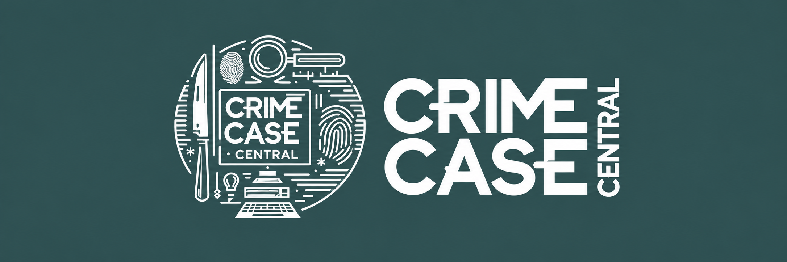

<p align="center">
  
</p>

<h1 align="center">Crime Case Central</h1>

<p align="center">
  <strong>Proyecto final de Desarrollo de Aplicaciones Web (DAW) · 2024</strong>
</p>

<p align="center">
  Laravel 10 · PHP · MySQL · Blade · JavaScript Vanilla · LAMP
</p>

<p align="center">
  <a href="#funcionalidades">Funcionalidades</a> ·
  <a href="#arquitectura-y-proceso-de-desarrollo">Arquitectura</a> ·
  <a href="#documentación-académica">Documentación</a> ·
  <a href="#instalación-en-local">Instalación</a>
</p>

## Sobre el proyecto

**Crime Case Central (CCC)** es una aplicación web para **centralizar y gestionar información sobre casos criminales**. Fue desarrollada conjuntamente como **proyecto final del Ciclo Formativo de Grado Superior en Desarrollo de Aplicaciones Web (DAW)** durante el curso 2023-2024.

La aplicación permite consultar y administrar fichas de casos, asociar imágenes, realizar búsquedas, registrar incidencias y gestionar usuarios con distintos permisos. El reto consistía en reunir estas operaciones en una misma interfaz y controlar qué puede hacer cada tipo de usuario.

### El proyecto de un vistazo

| | |
| --- | --- |
| **Tipo de proyecto** | Aplicación web full-stack · TFG de DAW |
| **Año** | 2024 (memoria entregada el 17 de junio) |
| **Equipo** | Ahmed Hassan Khamis y Christian M. Giménez Puerma, autoría al 50 % |
| **Tecnologías principales** | Laravel 10, PHP, MySQL, Blade, HTML, CSS y JavaScript Vanilla |
| **Puntos técnicos destacados** | CRUD de casos, roles y permisos, gestión de imágenes, búsquedas y control de acceso |
| **Material disponible** | Código fuente, [memoria completa](<docs/DAW2-Memoria-Proyecto-CrimeCaseCentral_(Entraga_final).pdf>) y [presentación de la defensa](<docs/Presentación Crime Case Central.pptx>) |

> **Contexto:** se publica como muestra del trabajo técnico y académico realizado en 2024. No es una plataforma oficial de investigación criminal ni una solución auditada para uso en producción.

## Funcionalidades

- **Acceso de usuarios:** inicio de sesión y control de acceso a las distintas secciones.
- **Gestión de casos:** creación, consulta, edición y eliminación de registros de crímenes, según los permisos del usuario.
- **Fichas detalladas:** título, descripción, fecha de denuncia, tipología, zona y *modus operandi*.
- **Gestión de imágenes:** imagen de portada y archivador de imágenes de los casos, con una interfaz de carga mediante *drag & drop*.
- **Búsqueda, ordenación y paginación:** consulta y filtrado de listados de casos, usuarios e incidencias.
- **Gestión de incidencias:** registro de incidencias vinculadas a casos y consulta administrativa.
- **Administración de usuarios:** alta, modificación, eliminación y asignación de niveles de permisos.
- **Control de sesión:** validación de acceso mediante middleware y control de intentos de inicio de sesión fallidos.
- **Mapa incrustado:** vista con un mapa de Google Maps integrado mediante `iframe` en el detalle de un caso.
- **Interfaz adaptable:** vistas desarrolladas con Blade, CSS y JavaScript, con diseños para escritorio y dispositivos móviles.

### Niveles de permisos

La aplicación define cinco niveles de acceso:

| Nivel | Valor | Función principal |
| --- | ---: | --- |
| Lector | 10 | Consultar casos. |
| Editor | 20 | Crear casos y gestionar los propios. |
| Moderador | 30 | Moderar casos y registrar incidencias. |
| Administrador | 40 | Gestionar casos, usuarios e incidencias. |
| Superadministrador | 50 | Nivel de acceso administrativo superior. |

Los permisos concretos se aplican mediante el middleware `ValidarPermisos` y las comprobaciones de la aplicación.

## Tecnologías utilizadas

| Área | Tecnología |
| --- | --- |
| Backend | PHP 8.1 o superior y Laravel 10 |
| Vistas | Laravel Blade |
| Frontend | HTML, CSS, JavaScript Vanilla y AJAX |
| Base de datos | MySQL |
| Servidor y entorno de despliegue documentado | Arquitectura LAMP (Linux, Apache, MySQL, PHP) |
| Gestión de dependencias PHP | Composer |
| Almacenamiento de imágenes | Sistema de archivos de Laravel |

## Arquitectura y proceso de desarrollo

El proyecto sigue una **arquitectura web de tres capas**:

1. **Presentación:** plantillas Blade de Laravel, HTML, CSS y JavaScript Vanilla, con peticiones AJAX para distintas interacciones.
2. **Lógica de negocio:** Laravel 10, rutas, controladores y *middleware* de autenticación y permisos.
3. **Persistencia:** MySQL para los registros y el sistema de archivos de Laravel para las imágenes.

### Decisiones y retos técnicos

- **Permisos por rol:** los *middleware* `EnsureTokenIsValid` y `ValidarPermisos` intervienen en la comprobación de las sesiones y el acceso a rutas según el nivel de usuario.
- **Gestión de imágenes asociadas a casos:** archivos de portada y archivador con carga mediante *drag & drop*, combinando interfaz JavaScript y almacenamiento de Laravel.
- **Persistencia de datos:** se optó principalmente por consultas SQL a través de la **fachada `DB` de Laravel**, en lugar de utilizar Eloquent como mecanismo principal. La memoria recoge la justificación de esta decisión.
- **Interactividad sin un framework de frontend adicional:** formularios, búsquedas y ordenación de listados desarrollados con JavaScript Vanilla y AJAX.

### Cómo se desarrolló

El equipo empleó **Extreme Programming (XP)**, con énfasis en el **pair programming** y el trabajo iterativo. Para el diseño se utilizó **Figma**, y se elaboraron diagramas UML, entidad-relación, modelo relacional y de flujo. La memoria también documenta las **pruebas manuales** y el proceso de despliegue en un entorno LAMP.

Como proyecto de portfolio, permite consultar tanto la implementación como las decisiones que la acompañaron: diseño de interfaces, estructura de datos, control de acceso y documentación técnica.

## Documentación académica

Además del código fuente, el repositorio incluye la **documentación académica original y las diapositivas utilizadas en la defensa**. Están en la carpeta **[`docs/`](docs/)**, al mismo nivel que `ccc-app/`:

- **[Memoria del proyecto (PDF)](<docs/DAW2-Memoria-Proyecto-CrimeCaseCentral_(Entraga_final).pdf>)**: documento de 80 páginas con introducción y objetivos, análisis y viabilidad, planificación, diseño de interfaces, arquitectura, diagramas, decisiones de implementación, código documentado, instalación y despliegue, formación de usuarios y bibliografía.
- **[Presentación del proyecto (PowerPoint)](<docs/Presentación Crime Case Central.pptx>)**: presentación utilizada en la defensa académica, con las funcionalidades, los diagramas, la arquitectura LAMP, la seguridad, la metodología de trabajo y los casos de uso.

Los diagramas de flujo, UML, entidad-relación y modelo relacional, así como los prototipos de interfaz, pueden consultarse en estos documentos.

## Estructura del repositorio

En la raíz del repositorio se sitúan el código de la aplicación, el README y la documentación académica:

```text
CrimeCaseCentral/
├── README.md
├── ccc-app/
│   ├── app/
│   │   └── Http/
│   │       ├── Controllers/       # Casos, usuarios, incidencias y búsquedas
│   │       └── Middleware/        # Control de acceso y permisos
│   ├── config/                   # Configuración de Laravel
│   ├── database/
│   │   └── sql/                  # Scripts SQL y usuarios de ejemplo
│   ├── public/
│   │   ├── css/                  # Estilos
│   │   ├── imgs/                 # Recursos gráficos
│   │   └── js/                   # JavaScript del frontend
│   ├── resources/
│   │   └── views/                # Plantillas Blade
│   ├── routes/
│   │   └── web.php               # Rutas de la aplicación
│   ├── storage/                  # Almacenamiento de Laravel
│   ├── composer.json
│   └── .env.example
└── docs/
    ├── DAW2-Memoria-Proyecto-CrimeCaseCentral_(Entraga_final).pdf
    └── Presentación Crime Case Central.pptx
```

Los nombres de los documentos coinciden con los de los archivos entregados originalmente para el proyecto. Los enlaces de la sección anterior funcionan siempre que se conserven estos nombres y esta ubicación.

## Instalación en local

### Requisitos

- PHP 8.1 o superior, con las extensiones necesarias para Laravel 10.
- Composer.
- Un servidor MySQL compatible con los scripts SQL del repositorio.

### 1. Preparar Laravel

Desde la carpeta del proyecto:

```bash
cd ccc-app
composer install
cp .env.example .env
php artisan key:generate
```

> En Windows, puedes copiar `.env.example` a `.env` manualmente o utilizar `copy .env.example .env`.

### 2. Configurar la base de datos

Edita el archivo `.env` con los datos de tu instalación local:

```dotenv
DB_CONNECTION=mysql
DB_HOST=127.0.0.1
DB_PORT=3306
DB_DATABASE=mydb
DB_USERNAME=tu_usuario
DB_PASSWORD=tu_contraseña
```

El proyecto incluye su propio esquema SQL en `database/sql/`. Para utilizar la versión que incorpora la tipología de los casos y los campos de control de intentos de acceso, importa **`ccc-db_v2.sql`**:

```bash
mysql -u tu_usuario -p < database/sql/ccc-db_v2.sql
```

**Atención:** este script contiene `DROP SCHEMA IF EXISTS mydb` y **elimina una base de datos existente llamada `mydb`**. Ejecútalo únicamente sobre un entorno local o una base de datos de pruebas que puedas descartar.

Opcionalmente, puedes cargar los usuarios de ejemplo:

```bash
mysql -u tu_usuario -p < database/sql/crear-usuarios.sql
```

Este segundo script también borra los registros de la tabla `usuarios` antes de insertar los ejemplos. Las contraseñas están almacenadas como hashes, por lo que tendrás que establecer una contraseña conocida para iniciar sesión. Por ejemplo, desde `php artisan tinker` puedes ejecutar:

```php
\Illuminate\Support\Facades\DB::table('usuarios')
    ->where('nombre', 'sudo')
    ->update([
        'password' => \Illuminate\Support\Facades\Hash::make('CAMBIA_ESTA_CONTRASEÑA')
    ]);
```

Utiliza una contraseña propia y no reutilices estas cuentas de demostración en un servidor público.

> La estructura específica de CCC está definida en los archivos SQL del repositorio; no se crea mediante las migraciones estándar de Laravel incluidas en el proyecto.

### 3. Preparar el almacenamiento e iniciar la aplicación

```bash
php artisan storage:link
php artisan serve
```

La aplicación estará disponible normalmente en **http://127.0.0.1:8000**. Los recursos CSS y JavaScript utilizados por las vistas están incluidos en `public/`.

## Contexto y alcance

Este repositorio conserva un **proyecto académico de 2024** y sus decisiones de implementación originales. Se comparte como parte del **portfolio técnico de sus autores**, para mostrar el producto desarrollado y su documentación, no como un servicio operativo.

La memoria y la presentación describen las medidas de seguridad planteadas e implementadas durante el TFG, pero **no constituyen una auditoría de seguridad**. Antes de usar la aplicación con datos reales o publicarla en Internet, sería necesario revisar código, configuración, dependencias y tratamiento de los datos.

## Autoría

Proyecto desarrollado conjuntamente por:

- **Ahmed Hassan Khamis — 50 % de la autoría.**
- **Christian M. Giménez Puerma — 50 % de la autoría.**

**Año:** 2024 · **Titulación:** Grado Superior en Desarrollo de Aplicaciones Web (DAW).

La autoría del **proyecto** se reconoce de forma conjunta y equitativa. Su publicación en un portfolio individual no altera este reparto.
